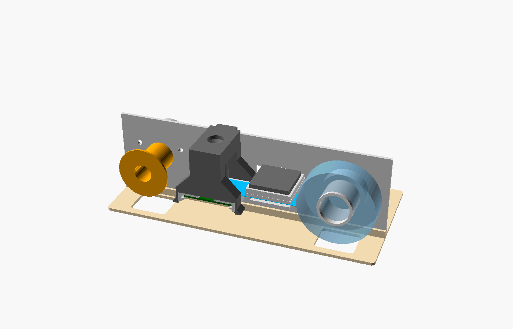

# Pollen Detector

A cheap, 3D-printable pollen sampler built around a Raspberry Pi.

A fan blows outdoor air onto a strip of clear sticky tape. A small motor moves the tape
along until that piece sits over a camera, and the camera takes a picture. Later, software
will count and recognise the pollen grains in the pictures.

The goal is to place many of these around Denmark (and further) and give better pollen
forecasts, the way [Sensor.Community](https://sensor.community) did for fine dust.
Today pollen is only counted at a few places, by hand, with expensive traps.

**Status:** early prototype. The software runs, the electronics are being wired, and the
3D printed parts are being designed. Nothing is calibrated yet.



## How it works

```
 tape roll ──► [ fan blows here ] ──► [ camera + LED ] ──► used tape roll
```

1. The fan blows on a fresh piece of tape for a while (for example 10 minutes).
2. The motor moves the tape along.
3. The LED turns on and the camera takes a picture of the tape.
4. The picture is saved and uploaded to a server.
5. Repeat.

The camera has no lens. The tape sits right on top of the camera sensor and the LED shines
through it from above. Pollen grains show up as small shadows.

## Build one yourself

Follow the **[build guide](https://deekahy.github.io/Pollen-Detector/)**
(the same pages are in [`docs/build/`](docs/build/index.md)). It goes through:

1. Parts and tools
2. Printing the 3D parts
3. Setting up the Pi
4. Soldering the HAT
5. Preparing the camera
6. Putting it together
7. Testing and calibrating
8. Running it

Want your own server for the pictures? See [server/README.md](server/README.md).

## What's in this repo

| Folder | What |
|---|---|
| `device/` | Software for the Raspberry Pi: controls the motor, fan, LED and camera, and has a web page for testing |
| `server/` | Small server that receives pictures from the devices |
| `hardware/` | 3D models (STL and source files) and the parts list |
| `docs/` | Wiring diagram, build guide, design ideas, links to research |
| `iterations/` | Photos and notes from each version we build |
| `ml/` | Pollen recognition (not started yet) |
| `report/` | Our project report in LaTeX. See [report/README.md](report/README.md) |
| `AGENTS.md` | Full project notes and decisions. Also used as context for AI assistants |

## Contributing

Ideas, test results and photos are very welcome. If you build one, add a folder in
`iterations/` with photos and what you learned, and open a pull request.

## Related work

- [osaukh/pollenpub](https://github.com/osaukh/pollenpub): an affordable automatic pollen
  monitor from ETH Zurich and TU Graz, with open hardware, code and data.
- More in [docs/references.md](docs/references.md).

## License

Everything we made is public domain, [CC0 1.0](LICENSE): the software, the 3D models, the
report text, the photos and the collected data. Use it for anything, no credit needed.
By contributing you agree to release your work under CC0.

The only exception is the AAU report template that `report/` is built on. It has its own
BSD 3-Clause license (`report/LICENSE-template`).
