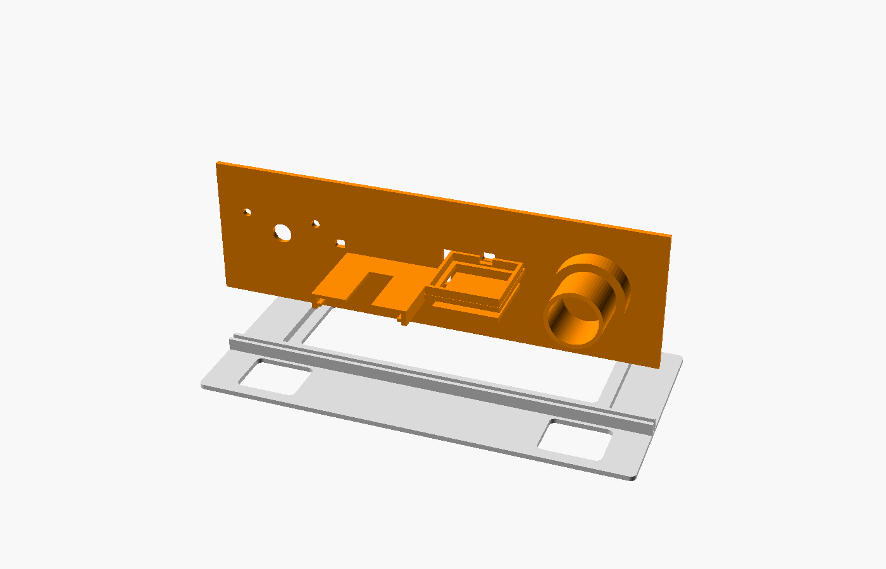
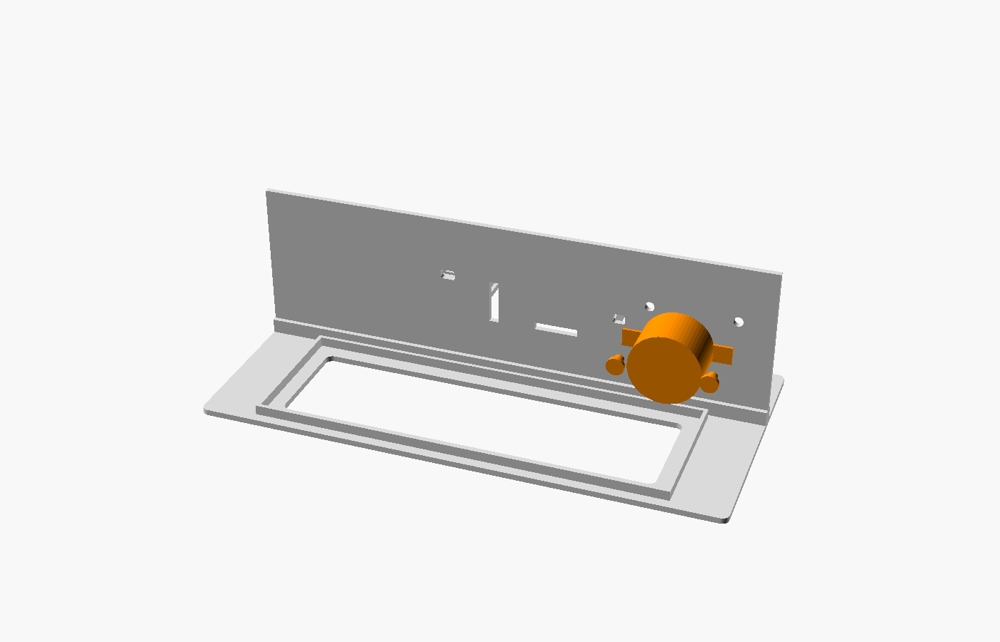
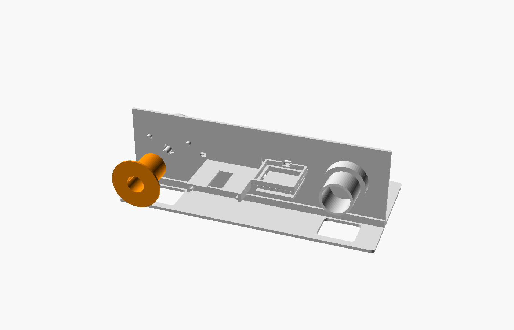
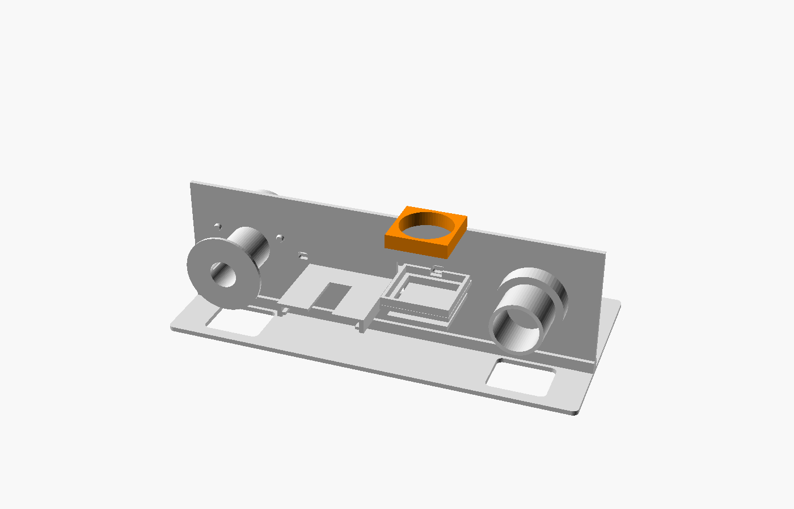
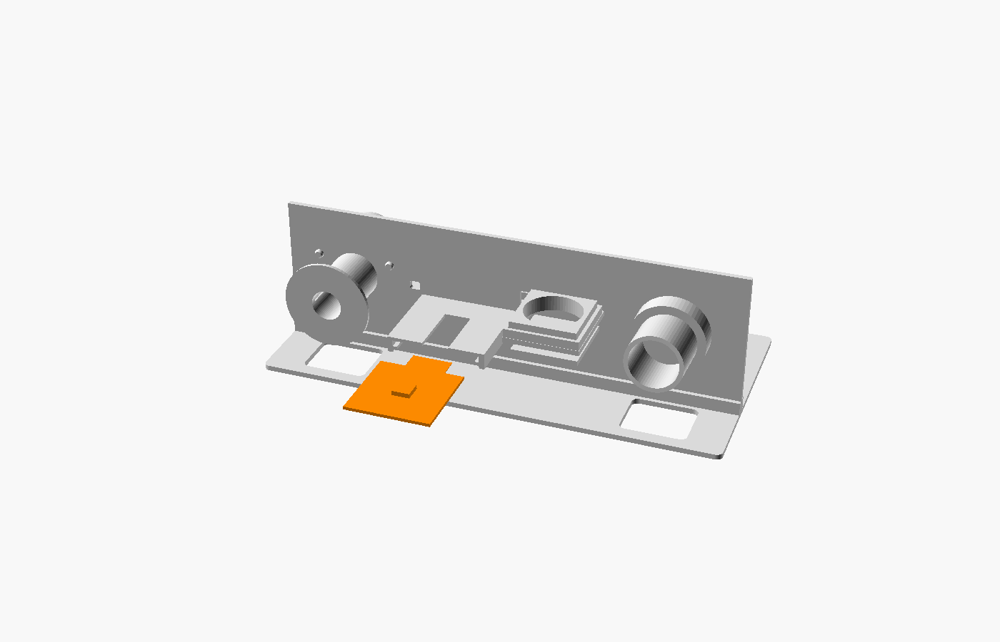
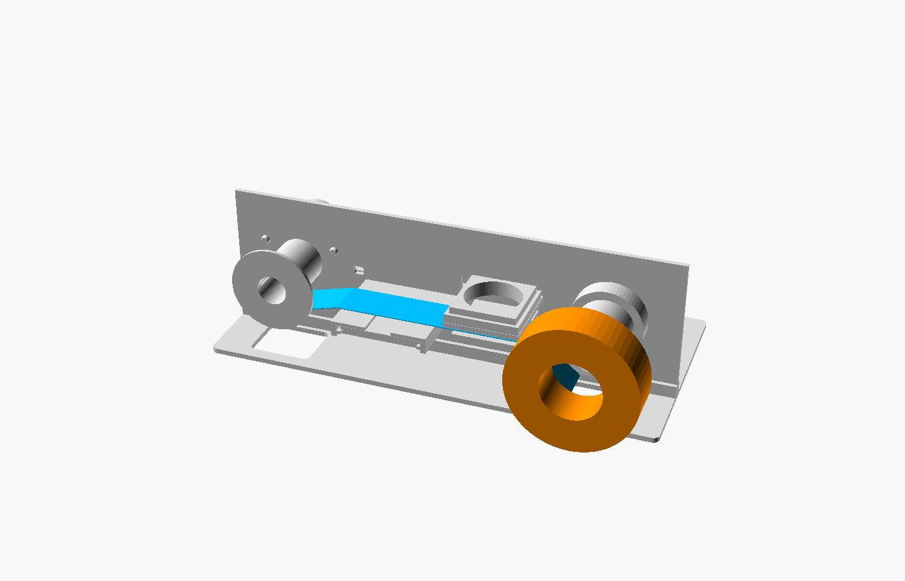
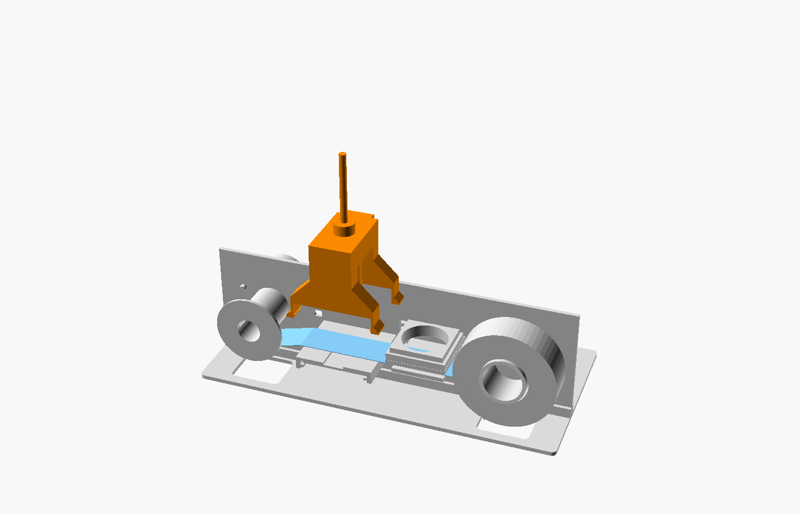
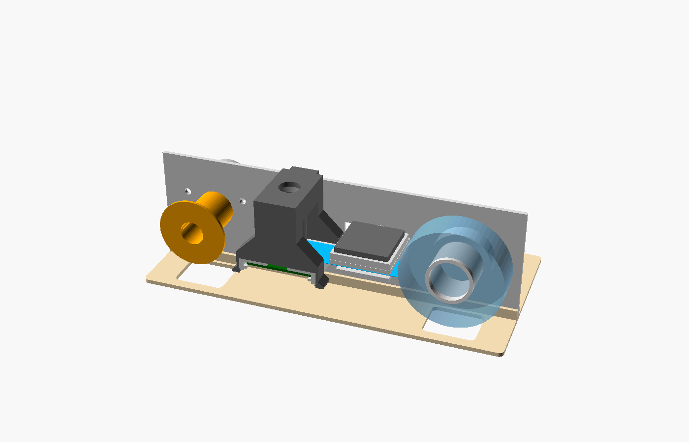

# 6. Put it together

**At the end of this step:** the finished sampler, with the tape threaded.

Everything presses or clips together. No glue and no screws. In the pictures, the parts already
fitted are grey and the part you add in that step is **orange**, pulled out a little along the way it goes on.

All pictures look at the **front** of the wall (the side with the camera box), except step 2.
Seen from the front, the tape roll is on the **right** and the motor spool on the **left**.

## 1. Frame into the tray

Push the bottom edge of the frame down into the groove in the tray, all along its length.
The camera box faces the narrow side of the tray, away from the big pocket.

## 2. Motor on the back

*Seen from behind.*

1. Push the motor shaft through the big hole in the wall, from the back.
2. Push a **motor pin** through each of the motor's two ears, into the small holes in the wall. They are tight on purpose.

## 3. Take-up spool on the shaft

Push the spool onto the motor shaft from the front, flange towards you. The shaft is flat on
two sides: turn the spool until it slides on.

## 4. Fan on the shelf

1. Put the fan wire through the small hole in the wall next to the shelf.
2. Press the fan down into the square rim on the shelf, **label side down** (so it blows down
   onto the tape). The wire goes in the notch on the wall side.

> [!NOTE]
> Check which way your fan blows: most fans blow out of the side with the label. Hold a strip of paper under it to be sure.

## 5. Camera into its box

1. Push the free end of the camera ribbon through the slot in the wall, right behind the camera box, from the **back**.
2. Connect it to the camera (see [step 5](camera.md#test-picture)).
3. Slide the camera into the box from the front, **sensor up**, on the two rails. Push it all the
   way in. The sensor must sit under the window in the roof.

## 6. Thread the tape

The **sticky side faces up the whole way**. Only the backing may touch plastic.

1. Slide the tape roll onto the peg. The tape comes off at the **bottom** of the roll, sticky side up.
2. Lead it under the fan, over the ledge and over the roof of the camera box.
3. Tuck the end into the slit in the take-up spool and turn the spool a few times by hand.
4. The tape should lie flat and tight over the camera window.

> [!NOTE]
> 📷 **Photo to add:** the tape threaded, from the front, close-up of the camera box.

## 7. Light tower

1. Push the NeoPixel (the first pixel of the string) into the top of the tower, lens down.
   The cable goes over the top of the wall to the back.
2. Push the tower straight down over the camera box, until it clicks. The tape runs through the
   gap under it and nothing touches the tape.

To take the tower off: pull the small tabs at the bottom of its four legs outward, about 1 mm, and lift.
You don't need to unthread the tape.

> [!TIP]
> Want sharper pictures? Put a small disc of kitchen foil with a needle hole in the cone before the NeoPixel.
> A smaller hole gives sharper shadows but less light.

## 8. Cables

Everything goes to the back of the wall, where the Pi with its HAT lies.
Plug in as in the [bench test](hat.md#bench-test):

- [ ] Fan on **J1**, red on +.
- [ ] NeoPixel input end on **J2**.
- [ ] Driver board on **J3** (power) and **J4** (IN1-IN4). Motor in the driver board.
- [ ] Camera ribbon from the camera, through the wall, to the Pi.

> [!NOTE]
> 📷 **Photo to add:** the back of the finished sampler with the Pi, HAT and cables.

