# 4. Build the HAT

**At the end of this step:** a soldered HAT on the Pi, with the fan, light and motor working on the table.

The HAT is a board that plugs onto the Pi's 40 pins. It holds the fan switch and the plugs for
the fan, the light and the motor. **Solder the HAT on its own. Never solder on the Pi itself.**
The HAT goes on the Pi at the very end of this page.

> [!WARNING]
> **Fumes.** Solder smoke is bad to breathe. Use a fume extractor, or a fan blowing the smoke
> away from you, and open a window. Turn it on *before* you heat the iron.

## The drawing is the instruction



How to read it:

- Top view. The 40-pin header is at the top.
- The lower area has **strips numbered 1 to 15** from the left. Each strip is 5 holes joined from
  top to bottom: **row 1** is the top hole, **row 5** the bottom one. Strips are not joined to each other.
- The **+5V** and **GND** rails at the bottom: every hole in a rail is joined.
- Parts sit on top. You solder on the underside.

Keep the drawing open next to you (print it, or a second screen). Every part's place is in it.

## Check the board first

Your board must match the drawing. With the multimeter on **beep**:

- [ ] Two holes in the same strip: beep. Two neighbouring strips: no beep.
- [ ] +5V rail to header pin 2: beep. Bottom GND rail to header pin 6: beep.
- [ ] The `#18` hole to header pin 12: beep.

If not, stop. Your board is a different layout and the drawing will not fit it.

## Solder in this order

Low parts first, tall parts last, so the board lies flat while you work.

> [!TIP]
> A strip of tape over a part holds it in place while you turn the board over. This helps a lot
> with the pin headers and the MOSFET.

| # | Part | Watch out |
|---|---|---|
| 1 | **J4**, 4 pins in `#18 #27 #22 #23` | Do it before the socket, it gets hard to reach after. `#17` stays empty |
| 2 | **40-pin socket**, on the **underside**, pointing down | Solder one pin at each end, check it sits flat, then the rest |
| 3 | **K1, K2, K3**, short wires | K1 and K2 cross the +5V rail: use insulated wire |
| 4 | **R1, R2, R3**, resistors | Read the colours. R1 and R2 swapped look fine but the fan will not work |
| 5 | **D1**, diode | **Stripe on the right** (strip 12, the 5V side). Wrong way = short circuit when the fan turns on |
| 6 | **W1, W2**, long wires | W1 goes in `#17`, right next to J4. Not in `#4` |
| 7 | **J1, J2, J3**, pin headers | Solder one pin, straighten the header, then the rest |
| 8 | **Q1**, MOSFET | **Metal tab towards the top** of the board. Turned around, the fan never turns off |

> [!NOTE]
> 📷 **Photo to add:** the finished HAT from the top, and from the underside.

> [!NOTE]
> 📷 **Photo to add:** close-up of D1 (stripe) and Q1 (tab direction) on the real board.

## Beep test before power

The HAT is **not** on the Pi. Multimeter on beep:

- [ ] +5V rail to GND rail: **no beep**. A beep is a short. Find it before you go on.
- [ ] +3V3 rail to the upper GND rail: no beep.
- [ ] Look at every joint with a bright light. No solder bridges between neighbouring holes.

## Put the HAT on the Pi

The Pi is **unplugged**. The camera ribbon must go in first, because the HAT covers the camera port.



1. Open the latch of the Pi's **CAMERA** port (lift the small dark bar). Push the ribbon in,
   **blue side towards the USB ports**, and close the latch. Leave the other end loose for now.
2. Thread the ribbon up through the **slot** in the HAT.
3. Hold the HAT over the Pi so the socket is over the Pi's pins. Look along the header from both
   ends: **all 40 pins** must be under the socket. No row of pins left over, no pin left over at the end.
4. Press straight down with both thumbs until the socket is all the way on.

> [!NOTE]
> 📷 **Photo to add:** HAT on the Pi seen from the side, showing the socket fully on and the ribbon coming out of the slot.

## Bench test

Test the electronics on the table now. Finding a mistake is much easier before it is all inside the frame.



Plug in, with the Pi still **unplugged**:

| Header | Goes to | Order (header at the top) |
|---|---|---|
| **J1** | Fan | − on top, **+ (red) at the bottom** |
| **J2** | NeoPixel string, **input end** | DIN top, 5V middle, GND bottom |
| **J3** | Driver board power | + top, − bottom |
| **J4** | Driver board IN1 IN2 IN3 IN4 | IN1 on the left |

Plug the motor into the driver board's white socket.

The NeoPixel string's input end has the arrows on the pixels pointing *away* from it. Wire
colours are not standard: read the labels (DIN, 5V or +, GND or −) on the first pixel.

Now plug in the Pi's power, wait a minute and log in (`ssh yourname@pollen-01.local`). Then:

```bash
cd ~/Pollen-Detector/device
sudo systemctl stop pollen
python3 -m pollen_device.hwtest --only led
python3 -m pollen_device.hwtest --only fan
python3 -m pollen_device.hwtest --only stepper
sudo systemctl start pollen
```

Each test asks you what you saw. Press **Enter** for yes, or **n** for no.

- [ ] The light shows red, green, blue, then white.
- [ ] The fan spins for 5 seconds.
- [ ] The motor shaft turns a quarter turn and comes back.

Something wrong? See [Troubleshooting](troubleshooting.md#hat-and-wiring).
The camera is tested after the next step.

Shut down (`sudo poweroff`) and unplug before you go on.
