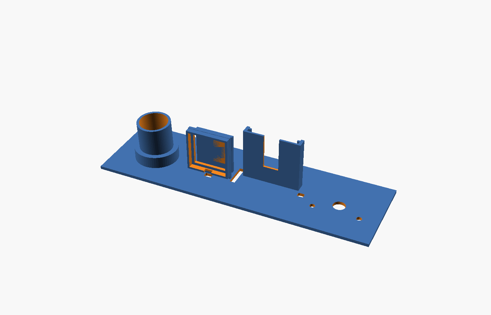
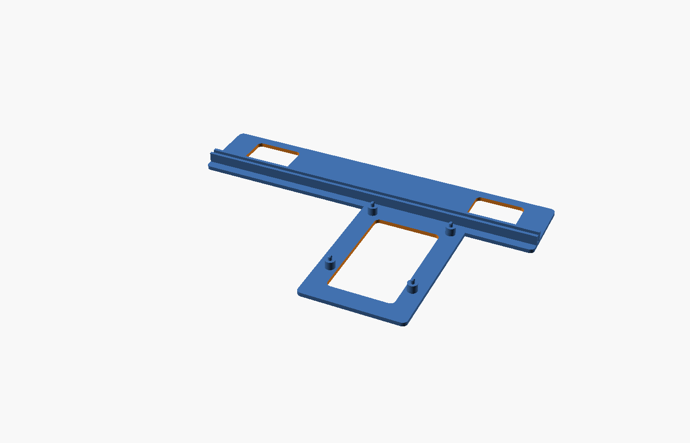
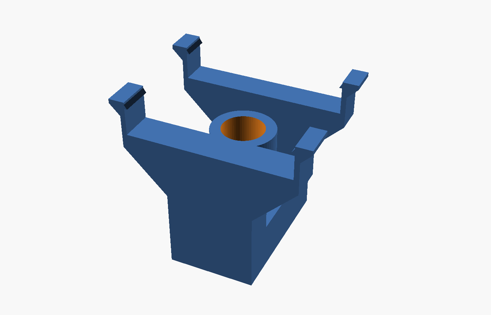
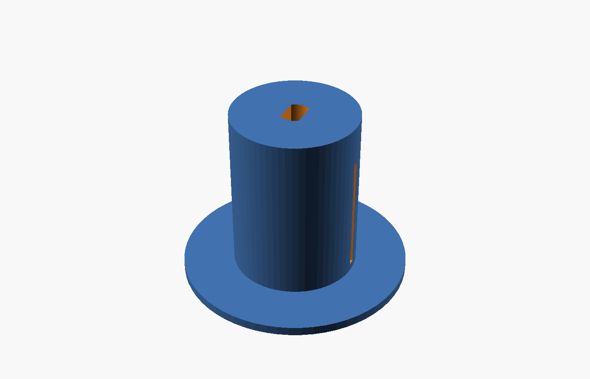
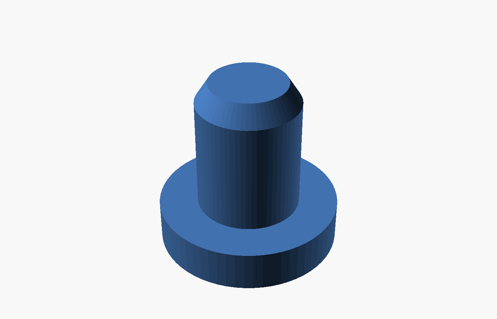
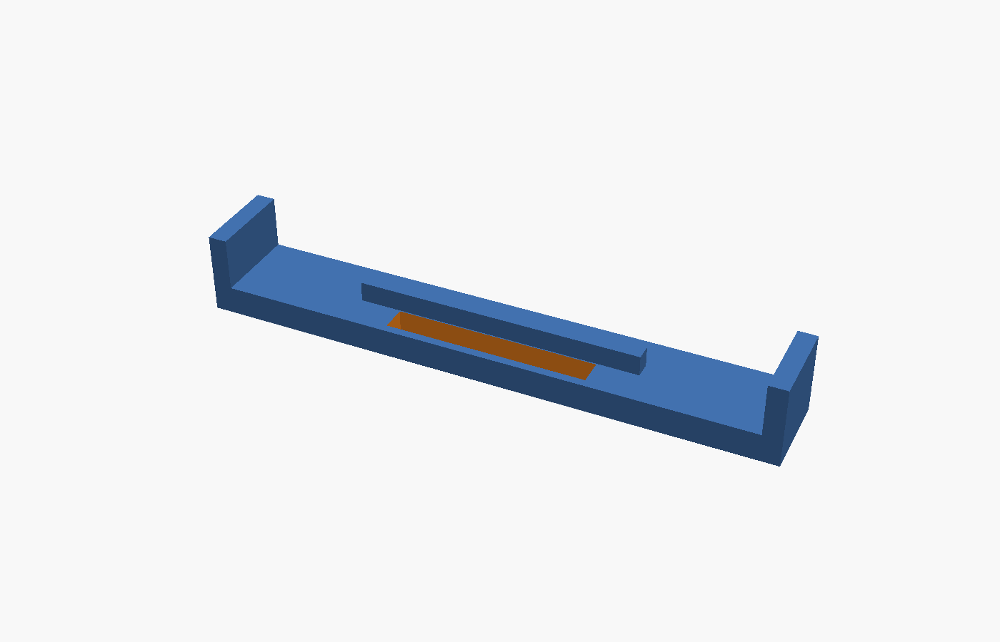

# 2. Print the parts

**At the end of this step:** 6 printed parts (the motor pin twice).

Start this first. The frame and tray take several hours each.

## Check your sizes first

The model is made in OpenSCAD and the sizes are settings at the top of
[`hardware/tape-deck/tape_deck.scad`](https://github.com/DeeKahy/Pollen-Detector/blob/main/hardware/tape-deck/tape_deck.scad).
The ready-made STL files use the defaults below. If your parts match, just print the STLs.

| Setting | Default | Check |
|---|---|---|
| `tape_w` | 19 mm | Width of your tape |
| `roll_od` | 58 mm | Outside of a full tape roll |
| `peg_d` | 26 mm | Inside of the tape roll's core |
| `fan_size` | 30 mm | Fan, one side of the square |

If one is different, change it in the `.scad` file and make new STLs:

```bash
cd hardware/tape-deck
for p in frame tray led_tower takeup_spool motor_pin; do
  openscad -D "part=\"$p\"" -o stl/$p.stl tape_deck.scad
done
```

(With Nix: `nix shell nixpkgs#openscad` first.)

## The parts

Files are in [`hardware/tape-deck/stl/`](https://github.com/DeeKahy/Pollen-Detector/tree/main/hardware/tape-deck/stl).
The pictures show each part the way it lies on the print bed.

| Part | Picture | File | Print it | How many |
|---|---|---|---|---|
| Frame | { width="260" } | `frame.stl` | Lying on its back, everything points up. No supports | 1 |
| Tray | { width="260" } | `tray.stl` | Flat | 1 |
| LED tower | { width="260" } | `led_tower.stl` | Top down. **Black** filament, so no light leaks through | 1 |
| Take-up spool | { width="260" } | `takeup_spool.stl` | Flange down | 1 |
| Motor pin | { width="260" } | `motor_pin.stl` | Head down | **2** |
| Camera plug | { width="260" } | `camera_plug.stl` | Plate down | Not needed now (the ribbon goes out the back) |

**Settings:** 0.2 mm layers, 3 walls, 15-20 % infill. No supports and no brim needed.
PLA is fine for indoor tests. Use PETG if it will stand outside (PLA goes soft in the sun).

> [!TIP]
> The 4 small pins on the tray hold the Raspberry Pi. Any full-size Pi fits (3B, 3B+, 4, 5).
> Check that the pins are not bent or stringy: they go through the Pi's mounting holes.

## Check the prints

- [ ] The motor pins and the spool have no strings or blobs in their holes.
- [ ] The tape channel under the LED tower (between its legs) is clean.
- [ ] The frame stands in the tray groove. Push it in now to test, it should be firm.

## If a fit is too tight or too loose

Every part is held by a press fit or a snap fit, so the fit depends on your printer. Change one of
these at the top of `tape_deck.scad` and print that part again:

| Problem | Setting | Default | Change |
|---|---|---|---|
| Spool will not go on the motor shaft, or slips | `shaft_fit` | 0.3 | bigger = looser |
| Fan, LED tower too tight or too loose | `clip` | 0.2 | bigger = looser |
| Frame in tray too tight or loose | `press` | 0.1 | bigger = looser |
| Camera does not slide in | `fit` | 0.3 | bigger = looser |
| LED tower too hard to snap on or off | `hook` | 0.8 | smaller = easier |

> [!NOTE]
> **For designers:** after any change, render `part = "tape_check"`. It must come out empty.
> Anything in it is plastic in the 2 mm above the sticky side of the tape. More in
> [`hardware/tape-deck/README.md`](https://github.com/DeeKahy/Pollen-Detector/blob/main/hardware/tape-deck/README.md).
