# Building the Proto HAT

This puts the fan switch, the light connector and the motor connectors on one
Proto HAT that plugs onto the Pi. No breadboard, no loose jumper wires on the Pi.

`hat.svg` is made by `make_hat_svg.py`. If a part moves, change it there and run the script again.

The pins are the same as in [wiring.md](wiring.md). The light is the **NeoPixel string**
(GPIO10). The old 5 mm RGB LED is not on the HAT.

## How to read the drawing

- Top view, with the 40-pin header at the top.
- The lower area has 15 **strips** on the left of the slot, numbered 1 to 15 from the left.
  Each strip is 5 holes, joined from top to bottom. **Row 1** is the top hole, **row 5** the bottom one.
- Strips are not joined to each other. Every hole in a rail (+5V, GND) is joined.
- Parts lie on top of the board. You solder on the underside.

## Parts

| ID | Part | Notes |
|---|---|---|
| — | Proto HAT ("RPi 2/RPi B+/RPi A+ Proto HAT w/EEP") | |
| — | 2x20 female header (socket) | goes underneath |
| J4 | 4-pin male header | motor IN1-IN4 |
| J1 | 2-pin male header | fan |
| J2 | 3-pin male header | NeoPixel string |
| J3 | 2-pin male header | motor driver power |
| R1 | 220 Ω resistor | red red brown |
| R2 | 100 kΩ resistor | brown black yellow |
| R3 | 330 Ω resistor | orange orange brown. 220 to 470 Ω also works |
| D1 | 1N5819 or 1N4148 diode | |
| Q1 | IRLZ44N MOSFET (TO-220) | an AO3400 is surface mount and will not fit the holes |
| K1-K3 | short insulated wire | 2 black, 1 red |
| W1, W2 | longer insulated wire | about 6 cm each |

Tools: soldering iron, solder, side cutters, wire stripper, multimeter.

## Steps

Solder the low parts first and the tall ones last, so the board lies flat while you work.

### 1. Check the board

Before soldering, check that the board matches the drawing. Set the multimeter to beep
(continuity) mode.

- Two holes in the same strip: beep.
- Two neighbouring strips: no beep.
- Strip 7, row 5, to the +5V hole just below it: no beep.
- +5V rail to the Pi's 5V pin hole (header pin 2): beep.
- Bottom GND rail to header pin 6: beep.
- The #18 hole to header pin 12: beep.

✔ If anything is different from this list, stop and tell the team. The drawing would be wrong.

### 2. Motor pins (J4)

Push a 4-pin male header into the holes **#18, #27, #22 and #23**, long side up.
Solder on the underside. **#17** (just left of it) stays empty, because W1 goes there later.

Do this before step 3, because the socket makes these joints hard to reach.

✔ 4 pins stand up in a row, starting at #18.

### 3. 40-pin socket

Put the 2x20 female socket on the **underside**, so it points down to the Pi. Solder it
on the top side. Solder one pin at each end first, check that the socket sits flat, then do the rest.

✔ The HAT pushes straight onto the Pi (power off). Take it off again.

### 4. Short wires (K1, K2, K3)

- K1 (black): strip 8 row 5 → GND rail. It goes over the +5V rail. Use insulated wire.
- K2 (black): strip 10 row 5 → GND rail. Also over the +5V rail.
- K3 (red): strip 12 row 5 → the +5V hole just below.

✔ The black wires do not touch the +5V holes they pass over.

### 5. Resistors (R1, R2, R3)

Bend the legs and lay the resistors flat. Direction does not matter.

- R1 220 Ω: strip 2 → strip 6, row 3.
- R2 100 kΩ: strip 6 → strip 10, row 4.
- R3 330 Ω: strip 11 → strip 15, row 2.

✔ Check the colour bands before you solder. 220 Ω and 100 kΩ swapped would still look fine but would not work.

### 6. Diode (D1)

Strip 7 → strip 12, row 3. **The stripe goes on the right** (strip 12, the 5V side).

✔ Stripe on the right. If it is the wrong way round, it shorts 5V to GND every time the fan turns on.

### 7. Long wires (W1, W2)

- W1: the **#17** hole → strip 2, row 1.
- W2: the **MOSI** hole → strip 11, row 1.

Let them lie flat over the upper area.

✔ W1 is in #17, right next to the motor header, not in #4.

### 8. Pin headers (J1, J2, J3)

These stand upright across the rails. One pin goes in each row or rail.

- J1 (2 pins): strip 7 row 5 (−) and the +5V hole below (+).
- J2 (3 pins): strip 15 row 5 (DIN), the +5V hole below (5V), the GND hole below that (GND).
- J3 (2 pins): the +5V and GND holes under strip 4.

✔ Each header stands straight up. Solder one pin, straighten it, then solder the rest.

### 9. MOSFET (Q1)

Legs in strips 6, 7 and 8, row 1. **The metal tab faces the top of the board**, so the
printed side faces the rails. Seen from the rails, the legs are G, D, S from left to right:
G in strip 6, D in strip 7, S in strip 8.

✔ The tab points to the top. Turned around, D and S swap and the fan never turns off.

### 10. Check before power

Pi unplugged, HAT not on the Pi. Use the multimeter in beep mode:

- +5V rail to GND rail: **no beep**. (A beep means a short. Find it before going on.)
- Upper +3V3 rail to upper GND rail: no beep.
- Look at every joint with a light. No solder bridges between neighbouring holes.

### 11. Plug in and test

1. Pi off. Put the camera ribbon through the slot first, then press the HAT onto the Pi.
2. Fan plug on J1: **red on +** (bottom pin), black on − (top pin).
3. NeoPixel string input end on J2: DIN top, 5V middle, GND bottom.
4. Motor driver: + and − on J3, IN1-IN4 on the J4 pins in the same order.
5. Power on. SPI must be on once: `sudo raspi-config nonint do_spi 0`, then reboot.
6. Set `led: type: neopixel` in `config.yaml` (see [wiring.md](wiring.md)).
7. Run `python3 -m pollen_device.hwtest`.

✔ The light shows red, green, blue and white, the fan spins, and the motor turns both ways.

## If something does not work

| Problem | Look at |
|---|---|
| Fan never turns off | Q1 turned the wrong way, or R2 missing |
| Fan never turns on | W1 in the wrong hole, R1 and R2 swapped, fan plug reversed |
| Pi resets when the fan starts | D1 the wrong way, or a weak power supply |
| Motor only buzzes | IN wires in the wrong order on the driver |
| Light flickers or shows random colours | See "Data level" in [wiring.md](wiring.md) |
| Nothing works, Pi gets hot | A short between +5V and GND. Unplug at once |
