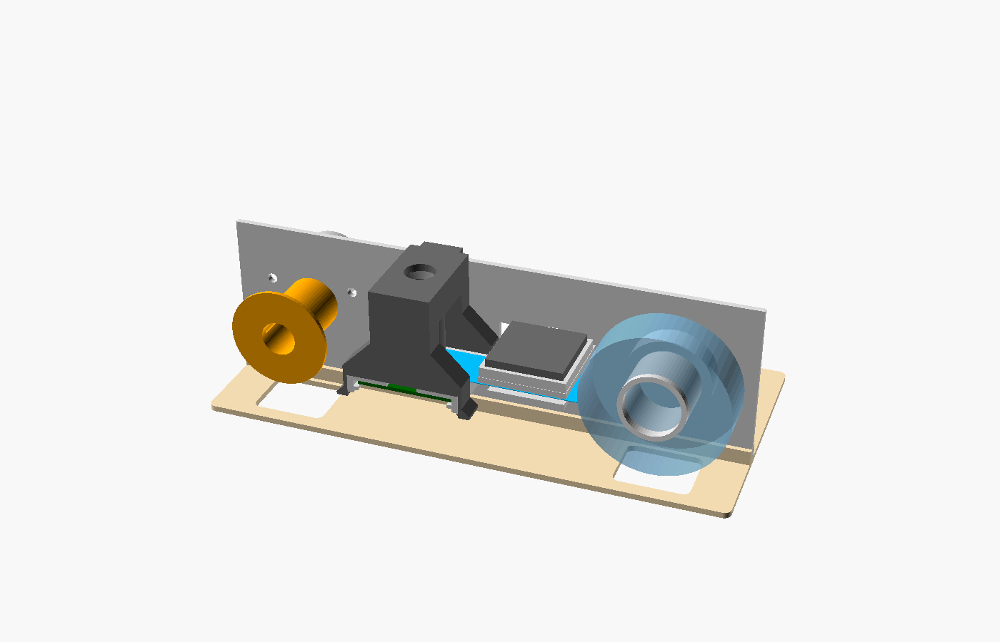

# Build a pollen sampler

This guide shows how to build our pollen sampler. The pollen sampler is a small contraption that
blows outdoor air onto sticky tape, moves the tape over a camera and takes pictures of what got
caught.

> [!NOTE]
> **Photo to add:** the real finished sampler, from the front, on a plain table.

> [!WARNING]
> This is a prototype. Parts of it will change, and most steps have not been tested properly.
> If something does not match or work or has issues, write down what you changed and tell us.

## What you need

- For parts see [Parts and tools](build/parts.md).
- A **3D printer**, or someone who can print about 200 g of PLA or PETG for you.
- A **soldering iron**.
- A **laptop** on the same network as the Pi (Wi-Fi or a cable).
- Time: about one day of work if you have all the parts, plus the printing time.

You do not need to know Python or Linux. You will type a few commands that are written out for you.

## The build process

The prints take time, so start with printing the parts. While it prints, set up the Pi and build
the HAT.

1. [Parts and tools](build/parts.md): get everything on the list.
2. [Print the parts](build/print.md): start the printer.
3. [Set up the Pi](build/pi-setup.md): put the software on the SD card, and check the web page opens.
4. [Build the HAT](build/hat.md): solder the board that sits on the Pi, and test it on the table.
5. [Prepare the camera](build/camera.md): take the lens mount off.
6. [Put it together](build/assembly.md): fit the printed parts, plug in the cables and thread the tape.
7. [Test and calibrate](build/first-run.md): check every part, get a sharp picture and measure the tape.
8. [Run it](build/run.md): start the schedule.

Stuck? See [Troubleshooting](build/troubleshooting.md). (Still a work in progress)

## How it works

1. The **fan** blows air down onto the sticky side of the tape. Pollen sticks to it.
2. The **motor** pulls the tape along, so that piece of tape moves over the **camera**.
3. A **light** above the tape shines through it. The camera has no lens: the tape lies right on
   the sensor, and the pollen casts tiny shadows on it.
4. The Pi saves the picture and, if you want, uploads it.

Every part is printed and pressed or clipped together. No glue and no screws.

All files are public domain (CC0). Build it, change it, share it.
