# Wiring (Raspberry Pi 3 B+)

`wiring.svg` is made by `make_wiring_svg.py`. If you change a pin, change it there and run the script again.

## Which wire goes where

| Pi pin | Name | Goes to |
|---|---|---|
| 2 | 5V | driver board `+` |
| 4 | 5V | fan red wire |
| 6 | GND | driver board `−` |
| 11 | GPIO17 | driver board IN1 |
| 13 | GPIO27 | driver board IN2 |
| 15 | GPIO22 | driver board IN3 |
| 16 | GPIO23 | driver board IN4 |
| 12 | GPIO18 | fan MOSFET, through a 220 Ω resistor |
| 14 | GND | fan MOSFET |
| 18 | GPIO24 | LED long leg, through a 47 Ω resistor |
| 20 | GND | LED short leg |
| CAMERA port | | HQ camera ribbon, blue side facing the USB ports |
| 1, 3, 5, 9 | | BME280 sensor (optional) |

The numbers in `device/config.yaml` are GPIO numbers (17, 27, ...), not pin numbers.

## The motor

The motor plugs into the driver board. The driver board gets 5V, GND and four wires from the Pi.
If the motor only buzzes and doesn't turn, the four IN wires are in the wrong order.

## The fan

The fan needs more current than a GPIO pin can give, so a MOSFET switches it.

- Fan red wire to 5V (pin 4). Fan black wire to the MOSFET's D leg.
- MOSFET S leg to GND (pin 14).
- GPIO18 (pin 12) to a 220 Ω resistor, then to the MOSFET's G leg.
- A 100 kΩ resistor from the G leg to GND. This keeps the fan off while the Pi starts.
- A diode across the fan, with the stripe on the 5V side. This protects the MOSFET.

## The LED

The LED goes straight on a GPIO pin.

- GPIO24 (pin 18) to a 47 Ω resistor, then to the LED's long leg.
- LED short leg to GND (pin 20).
- For a red or green LED, use 150 Ω instead.

A GPIO pin only gives about 16 mA, so the LED is a bit dim. That's fine. Just use a longer
camera exposure. The LED sits a few cm above the tape, right over the camera.
A pinhole under it (foil poked with a needle) makes the lensless pictures sharper.

Resistor colour codes are in [resistors.svg](resistors.svg).

## What to buy

| Part | How many | Notes |
|---|---|---|
| ULN2003 driver board | 1 | usually comes with the motor |
| Logic-level MOSFET | 1 | IRLZ44N or AO3400. Not the blue IRF520 boards, they don't work at 3.3 V |
| 220 Ω resistor | 1 | fan MOSFET |
| 100 kΩ resistor | 1 | fan MOSFET |
| 1N5819 or 1N4148 diode | 1 | across the fan |
| White 5 mm LED + 47 Ω resistor | 1 | |
| 5.1 V 2.5 A micro USB power supply | 1 | a weak supply makes the Pi crash at random |
| Breadboard and jumper wires | | |
| microSD card, 32 GB or more | 1 | the pictures are big |
| BME280 sensor (optional) | 1 | logs temperature and humidity |

## Before you power on

1. Wire it all with the Pi unplugged.
2. Check that no 5V wire goes to a GPIO pin. 5V on a GPIO pin kills it.
3. Connect all GND wires together.
4. Power on and run `python3 -m pollen_device.hwtest`. It tests the LED, fan, motor and camera one at a time.
