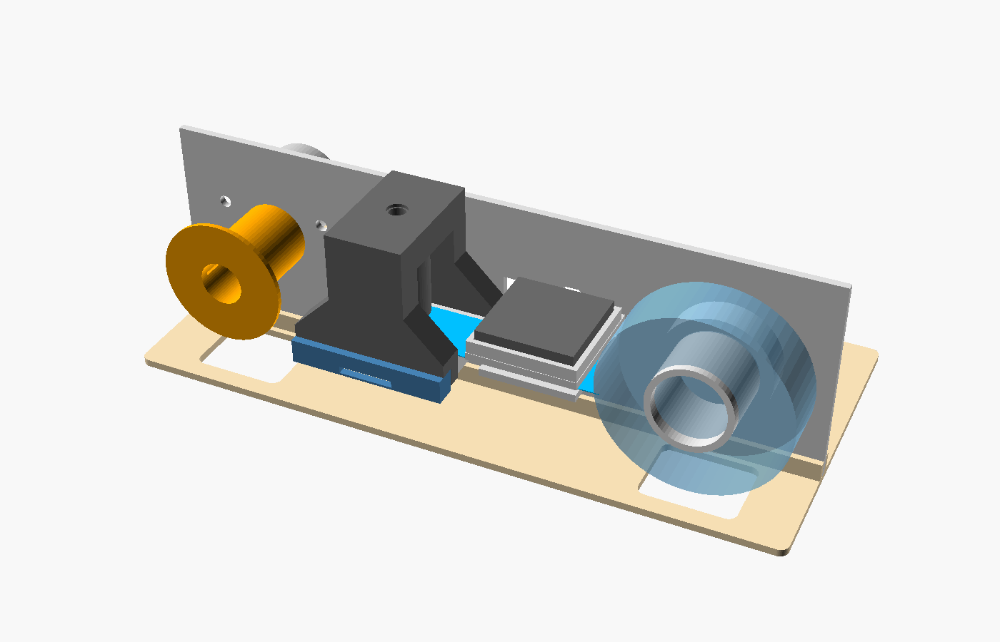
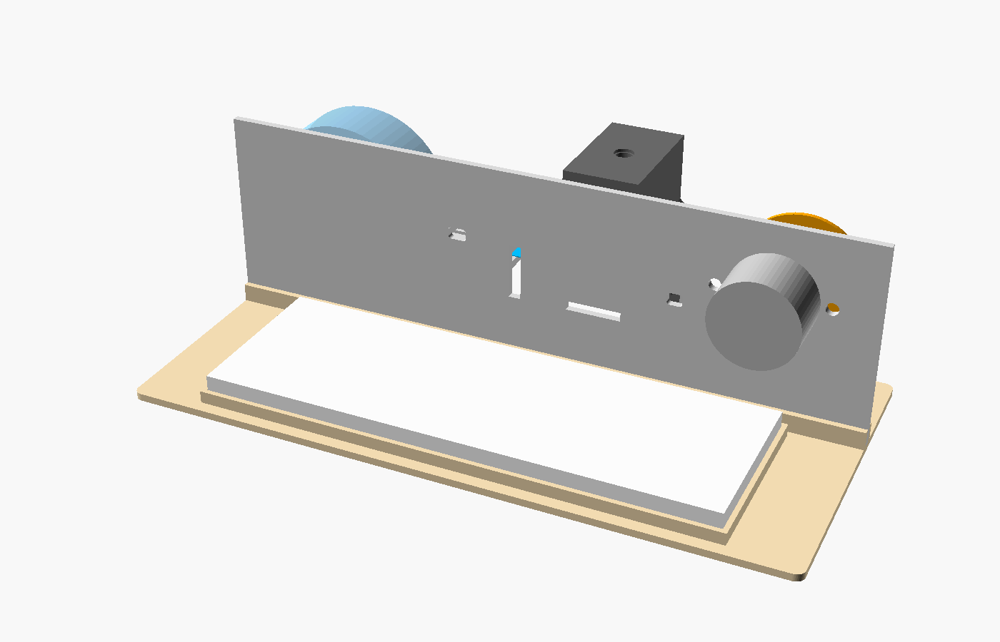
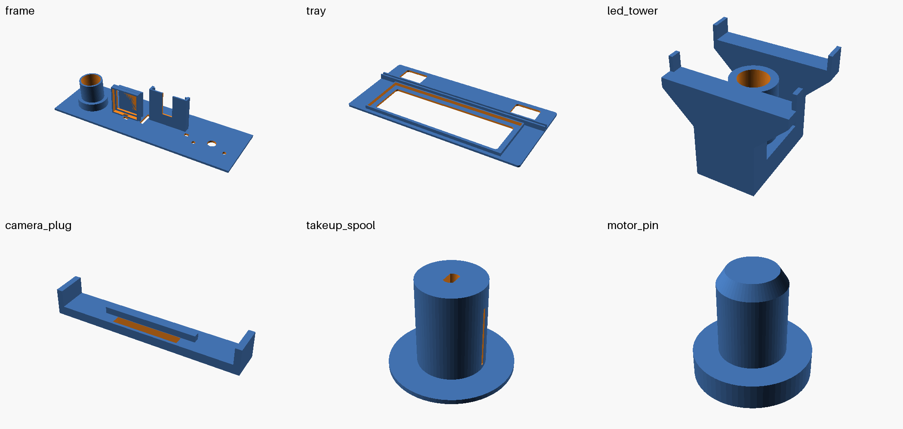

# Prototype frame (simple)

A simple, parametric OpenSCAD design for the prototype. One flat wall that everything hangs
off, standing in a tray. The first print (2026-10-29) showed several fit problems; they are fixed
here but this version has **not been printed yet**. Measure your parts first (below).



## How it works

**Front of the wall**, in the order the tape goes:

1. **Tape roll** slides sideways onto a 26 mm peg. The peg tilts up 4°, so the roll slides back
   against the collar by itself.
2. **Fan** presses into a rim on a shelf and blows down onto the tape, 8 mm above it. A small ledge under the
   tape keeps the air from just pushing the tape away.
3. **Camera box.** The camera slides in from the front on two rails, with the sensor under a
   window in the roof. The metal lens mount and tripod block must be off the board: they don't fit. The tape runs over the roof, so the gap to the sensor (1 mm) is set by the
   print. The **camera plug** is a cap over the front of the box, with a slit for the ribbon.
4. **LED tower** snaps onto the camera box, with the NeoPixel on top and a 1.5 mm pinhole 26 mm above the tape. The tape runs
   through an open channel under it (23 mm wide, the tube ends 4 mm above the tape).
   Thread the tape first, then push the tower straight down until it clicks:
   - four skirts reach down past the bottom edge of the box walls and hook under it,
   - a tab at the top reaches over the wall, with a lip down the back, so it can't tip forward.

   **To take it off:** pull the tabs at the bottom of the skirts outward, about 1 mm, and lift.
   Nothing of the tower is under the tape, so it comes off and goes on without unthreading it. If it is too hard to get on or off, lower `hook` (0.8) or `tsk` (skirt thickness, 1.4).
5. **Take-up spool** on the motor shaft pulls the tape in.

The tape keeps its sticky side up and only the backing touches plastic. `part = "tape_check"`
checks this: it must come out empty, or something solid is in the 2 mm above the sticky side.

**Back of the wall:** the motor (shaft through the wall). On the tray, a full-size breadboard
right next to the wall, so the motor, fan and LED wires are short. The Raspberry Pi has no mount
for now: it just sits behind the tray on its ribbon cable. Cables to the back:

- **Camera ribbon:** an 18 × 3 mm slot through the wall right behind the camera box, just under
  the board. Slide the camera in connector first and the ribbon goes straight back to the Pi.
  Or use the slit in the camera plug and the narrow slot next to the box.
- **Motor:** already on the back, nothing to route.
- **LED:** the NeoPixel's cable comes out of the top of the tower, just above the wall, so it goes over
  the top. There is also a small hole next to the box.
- **Fan:** a small hole next to the fan shelf.



## Parts



| Part | File | Size (mm) | Print |
|---|---|---|---|
| Frame | `stl/frame.stl` | 214 × 66, 42 high | lying on its back, everything points up, no supports |
| Tray | `stl/tray.stl` | 214 × 104 | flat. The frame presses into the groove |
| LED tower | `stl/led_tower.stl` | 48 × 40 × 44 | top down. **Black** filament |
| Camera plug | `stl/camera_plug.stl` | 48 × 7 × 7 | plate down |
| Take-up spool | `stl/takeup_spool.stl` | Ø40 × 31 | flange down |
| Motor pin | `stl/motor_pin.stl` | Ø7 × 7 | head down. Print **2** |

PLA is fine for the prototype.

## No glue, no screws

Everything holds by a press fit or a snap fit:

| What | How |
|---|---|
| Frame | presses into the groove in the tray |
| Tape roll | slides onto the tilted peg, gravity keeps it on |
| Fan | presses into the rim on the shelf (notch for its wire on the wall side) |
| Camera | slides in on the rails, the plug caps the front (side tabs hug the box) |
| LED tower | snap hooks under the camera box walls, and a hook over the top of the wall |
| NeoPixel | nipple (lens) down into its hole, the body sits 3 mm deep in a pocket at the top (friction) |
| Motor | 2 printed pins: through the motor ears into tight holes in the wall |
| Take-up spool | D-hole on the motor shaft (0.3 mm bigger than the shaft, plastic shrinks) |
| Breadboard | presses into a pocket on the tray |

If a fit is too tight or too loose on your printer, change these at the top of `tape_deck.scad`
and export again: `shaft_fit` (motor shaft, 0.3), `clip` (fan rim, LED tower, plug, 0.2),
`press` (frame in tray, breadboard, 0.1), `fit` (camera, 0.3).

## Measure these first

At the top of `tape_deck.scad`. Change them and export again.

| Setting | Default | What |
|---|---|---|
| `tape_w` | 19 | Tape width |
| `roll_od` | 58 | Full roll, outside |
| `peg_d` | 26 | Peg for the roll's plastic core |
| `fan_size` | 30 | Fan frame, square. Pi case fans are mostly 30, some 25. Thickness doesn't matter |
| `sensor_h` | 2.0 | Camera board top to sensor glass top, lens mount off. A guess, not on the official drawing. **Measure this**: it sets the gap to the tape |
| `board_t` | 1.4 | Camera board thickness (official drawing) |
| `gap` | 1.0 | Tape to sensor |
| `cam_gap` | 5 | Free space between the fan shelf and the LED tower |
| `bb_size` | 165 × 55 | Breadboard (full size; half size is 83 × 55) |

## The pinhole

The light shines through a **1.5 mm pinhole** (`pinhole`) printed in a thin lip at the bottom of
a 45° cone (`aperture`, 2.5 mm), so it prints top down without a flat bridge. A smaller light
source gives sharper shadows: blur is about hole size × tape-to-sensor gap ÷ hole height. With
the old 2.5 mm hole the flour grains were blurred to about 0.14 mm; 1.5 mm should give about
0.08 mm. It lets through about 3× less light than 2.5 mm, so the exposure gets a bit longer
(run Auto setup). A 0.6 mm hole was tried and was too small.

For an even smaller hole, a disc of kitchen foil with a needle hole can still go in the cone
before the NeoPixel.

The NeoPixel sizes are `nipple_d` (7.7), `nipple_l` (7) and `body_d` (12, not measured yet:
check it). Run **Auto setup** in the web page after each change and compare the "detail" score.

## Make the STL files

With OpenSCAD (or `nix shell nixpkgs#openscad`), from this folder:

```bash
for p in frame tray led_tower camera_plug takeup_spool motor_pin; do openscad -D "part=\"$p\"" -o stl/$p.stl tape_deck.scad; done
```

`part = "assembly"` (the default) shows everything together, `part = "section"` cuts it along the tape.
